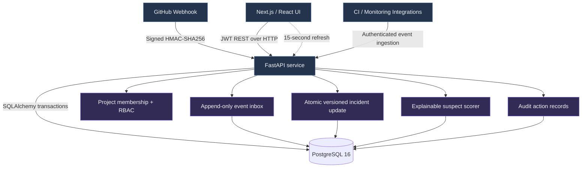
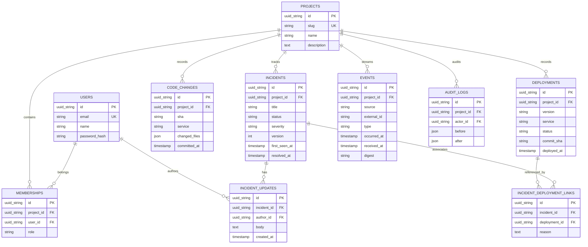
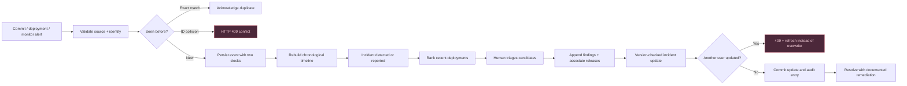

# Diagrams (renderable directly on GitHub)

These diagrams are generated from the project design. The `.mmd` sources can be edited in Mermaid Live Editor.

## System architecture

## Database ERD

## Incident investigation workflow

